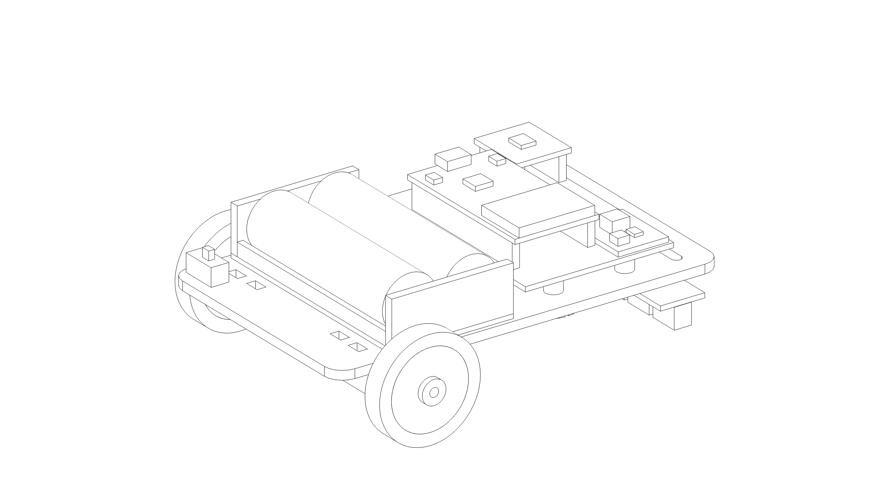
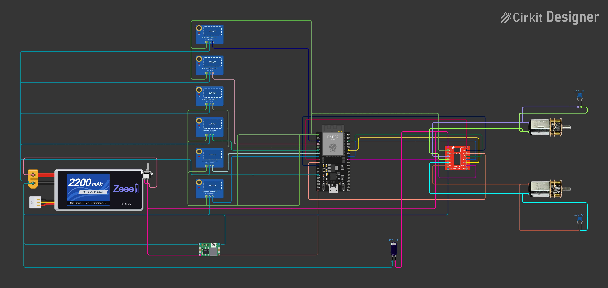
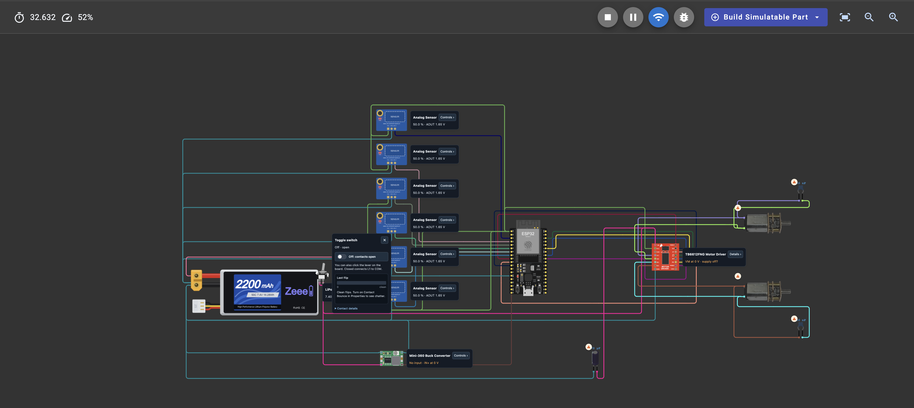
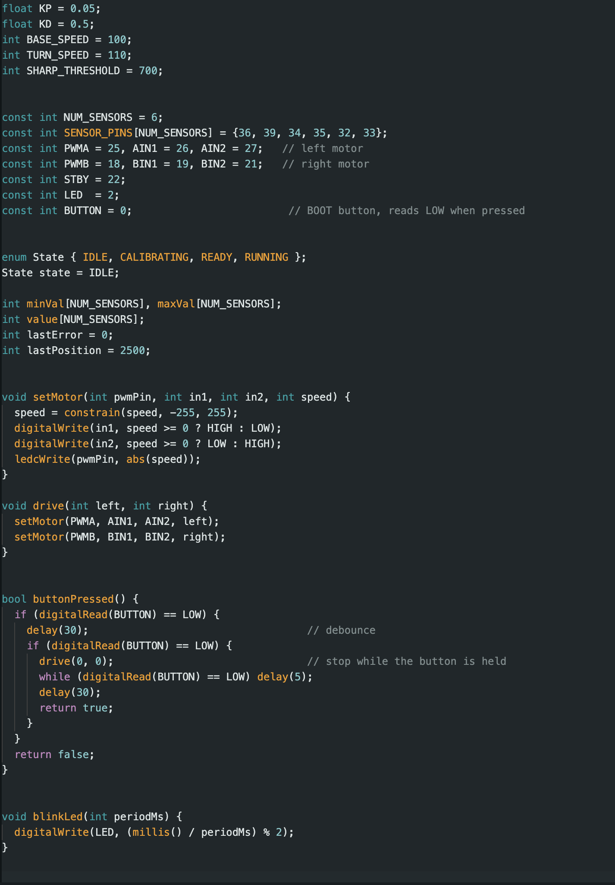
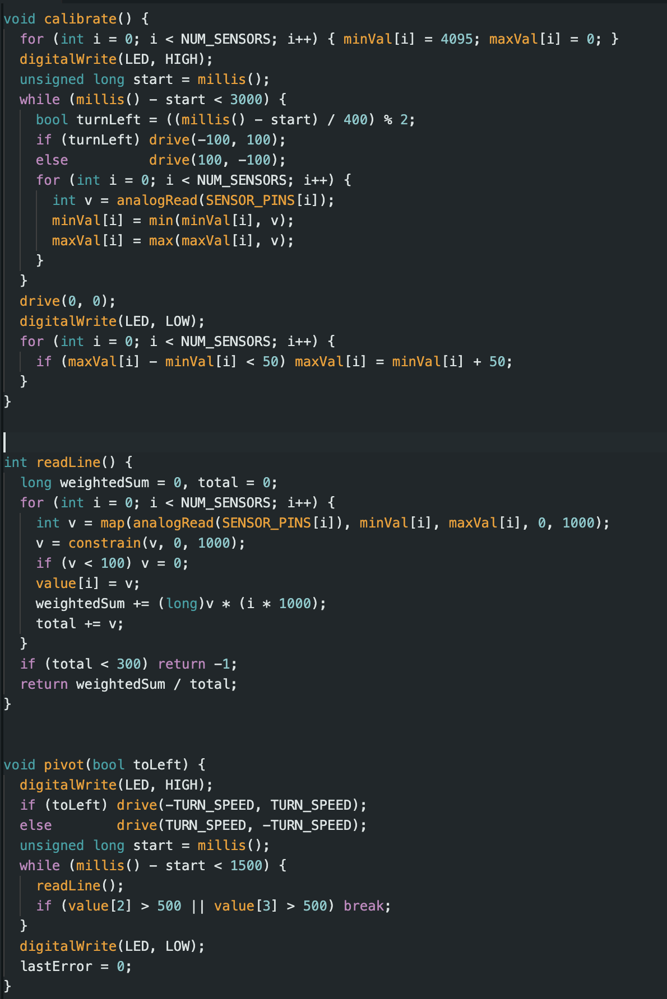

# Line Follower Bot (ESP32)

A beginner-friendly, well-documented line follower robot: ESP32 + 6 analog IR sensors + TB6612FNG + two N20 motors, with PD control, sharp-turn handling and a one-button state machine.

## Folder contents

| Path | What it is |
|---|---|
| [`BOM.md`](BOM.md) / [`BOM.csv`](BOM.csv) | Bill of materials with USD prices (total ≈ **$86**) |
| [`code/line_follower/line_follower.ino`](code/line_follower/line_follower.ino) | **Final code**: upload this to the robot |
| [`code/learning-steps/`](code/learning-steps) | 7 step-by-step sketches (motor test → final), one new idea per step |
| [`images/`](images) | Circuit diagram, simulation, code screenshots, CAD render |
| [`cad/`](cad) | 3D-printable chassis: `chassis.stl` (print), `chassis.scad` (editable source) |
| [`docs/BUILD_GUIDE.md`](docs/BUILD_GUIDE.md) | Full build guide: wiring, steps, PID explained, tuning, troubleshooting, journal template |
| [`docs/CIRCUIT_PROMPT.md`](docs/CIRCUIT_PROMPT.md) | Cirkit Designer prompt + pin table |

## Circuit

| ESP32 pin | Connects to |
|---|---|
| GPIO36, 39, 34, 35, 32, 33 | IR sensors 1–6 AOUT (left → right) |
| GPIO25 / 26 / 27 | TB6612 PWMA / AI1 / AI2 (left motor) |
| GPIO18 / 19 / 21 | TB6612 PWMB / BI1 / BI2 (right motor) |
| GPIO22 | TB6612 STBY |
| 3V3 | TB6612 VCC + sensor VCC |
| 5V | Mini-360 buck output (5.0 V) |
| GPIO0 / GPIO2 | Onboard BOOT button (start/stop) / onboard LED |

Power: 2S LiPo → XT60 → toggle switch → TB6612 VM (with 470 µF cap) and Mini-360 input. 100 nF across each motor.

## Quick start

1. Print `cad/chassis.stl` (top face down, no supports).
2. Wire it up as shown in the diagram. **Set the buck converter to 5.0 V first.**
3. Upload `code/learning-steps/01_motor_test` to check both wheels spin forward (swap motor wires if not).
4. Upload `code/line_follower/line_follower.ino` (board: *ESP32 Dev Module*, ESP32 Arduino core 3.x).
5. Power on, put the bot on the line, and press **BOOT** to calibrate. When the LED blinks fast, press **BOOT** again to run.

## Images

| | |
|---|---|
|  |  |
| Circuit simulation (Cirkit Designer) | CAD assembly (Fusion 360) |
|  |  |
| Code: config, motors, button | Code: calibration, line reading, pivot |
